

# EvidLab

**Chemical & lab-material inventory for a university chemistry department — replacing a shared Excel sheet with approvals, a full audit trail, GHS safety data and explainable procurement.**

**[Website](https://evidlab.vercel.app)** · **[Live demo](https://evidlab-demo-web.onrender.com)** · **[Illustrated guide](https://evidlab-demo-web.onrender.com/uputstvo/index.html)**

*Team project · Faculty of Sciences (PMF), University of Novi Sad · real departmental client · in pilot use at the Department of Chemistry since October 2026*

> **Live demo:** [evidlab-demo-web.onrender.com](https://evidlab-demo-web.onrender.com) runs the same release as the
> pilot, filled with a fictional "two years of use" dataset (56 chemicals, 180 batches, ~2,000 requests, 12 demo users).
> It needs a login. Demo accounts are handed out on request, and live walkthroughs can be booked on the
> [website](https://evidlab.vercel.app/prikaz/). It runs on a free tier, so the first load after a quiet period can take a minute.
> The UI in the demo and on the website is Serbian; English is a per-installation setting.

> **Source code is private.** The system is in pilot use at the faculty and the codebase contains teammates' work, so
> this repository is a showcase only: screenshots, architecture and my role. All app screenshots use the fictional demo
> dataset (demo lab, demo users, demo suppliers), not the department's inventory.

---

## Gallery

**Public website** ([evidlab.vercel.app](https://evidlab.vercel.app)): a static Astro site for lab managers and
safety officers. The hero label "ages" as you scroll, and its stock and status are recomputed from the ledger rows.

| | |
|---|---|
| 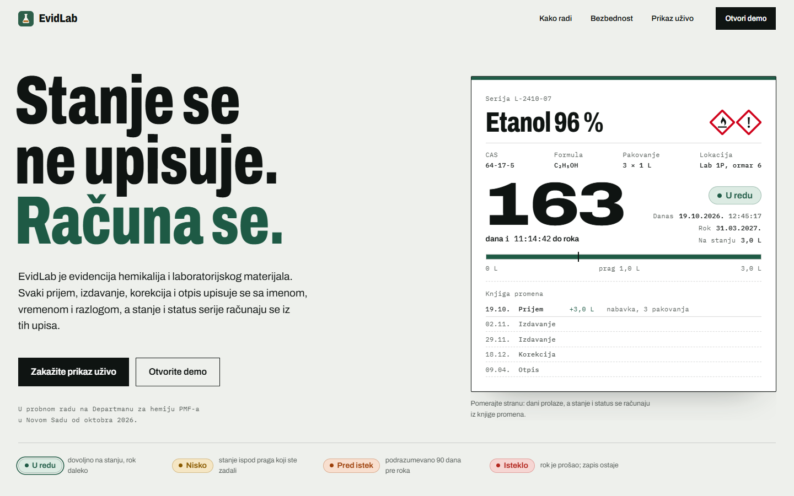 **Website**, 1440 px | 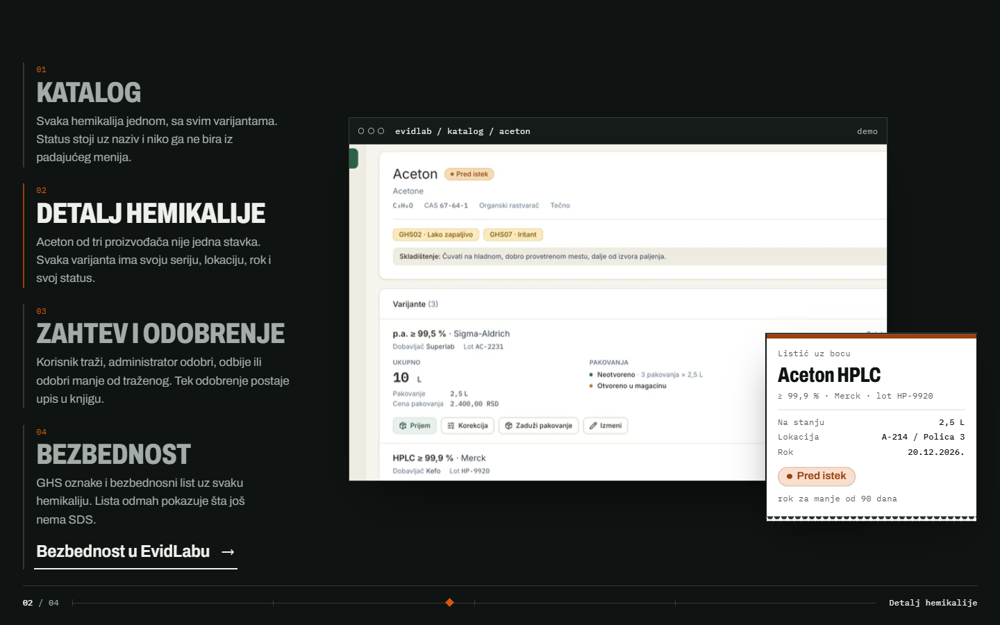 **App tour** on the website: each screen next to the "label" it produces |

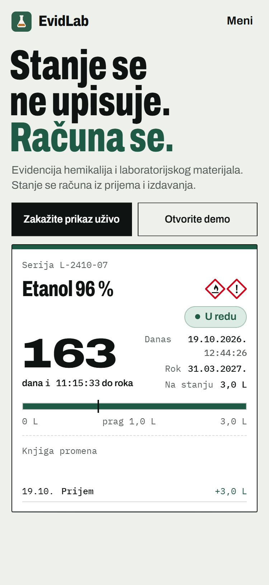

**The application** (demo data):

| | |
|---|---|
| 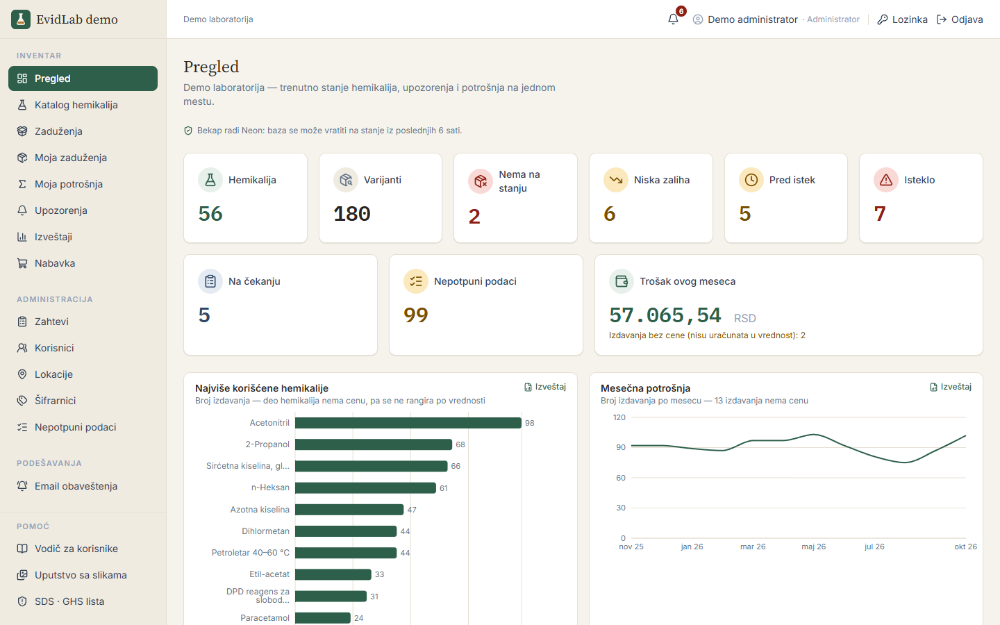 **Dashboard**: stock health, expiry, pending requests, incomplete data, monthly cost, consumption charts | 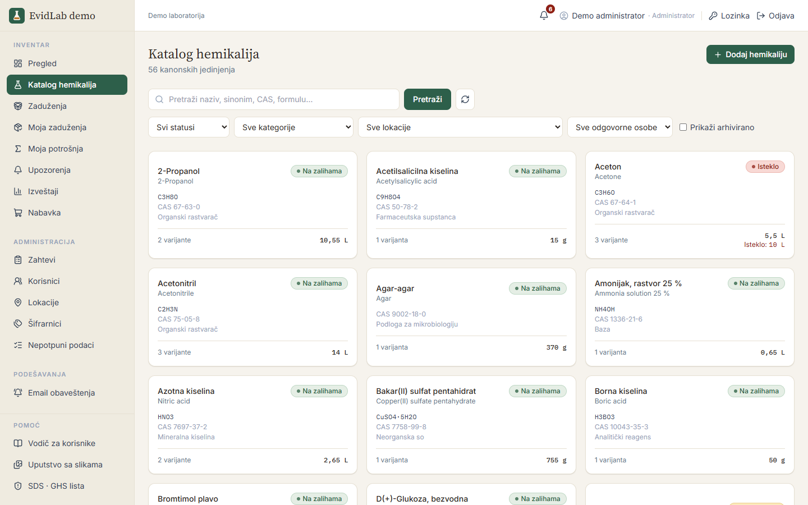 **Chemical catalog**: one canonical chemical with its variants and a computed status |
| 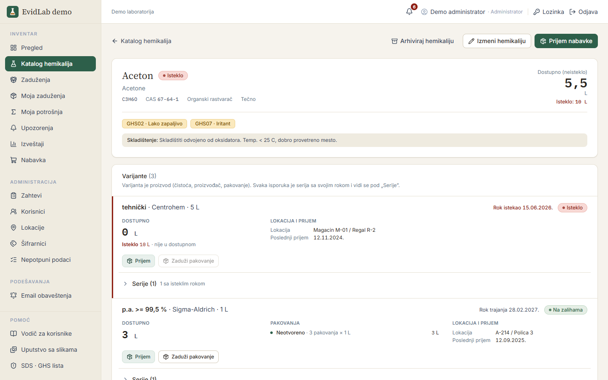 **Chemical detail**: GHS hazards, variants (products) with batches, locations, expired stock kept separate | 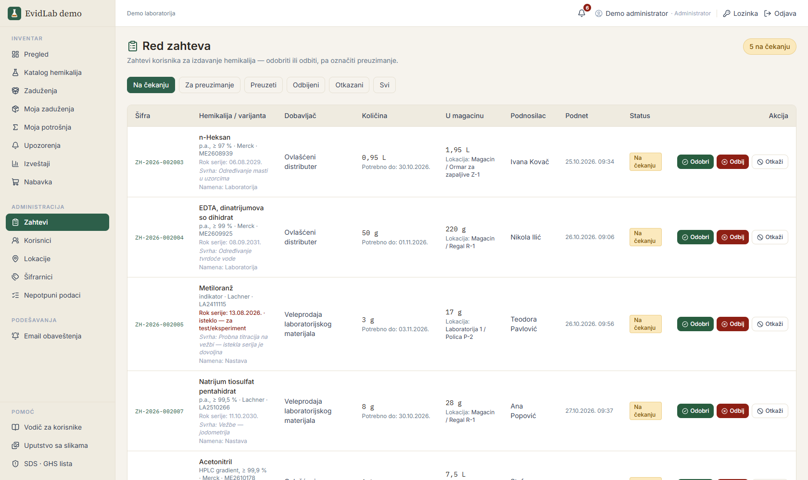 **Request queue**: approve, approve less, reject or cancel; then "picked up" |
| 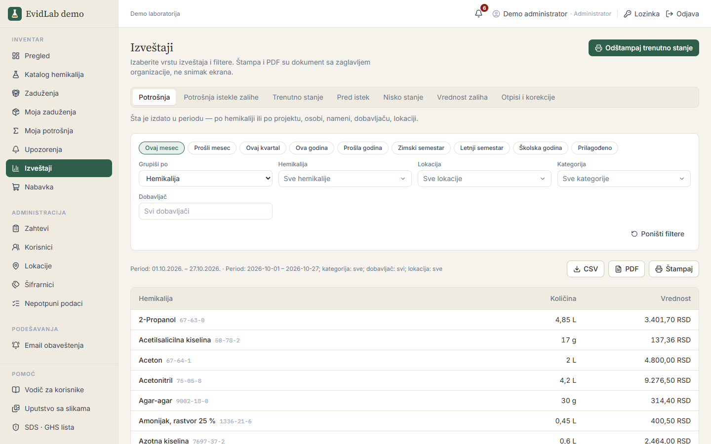 **Reports**: 7 report types, academic periods, CSV / PDF / print | 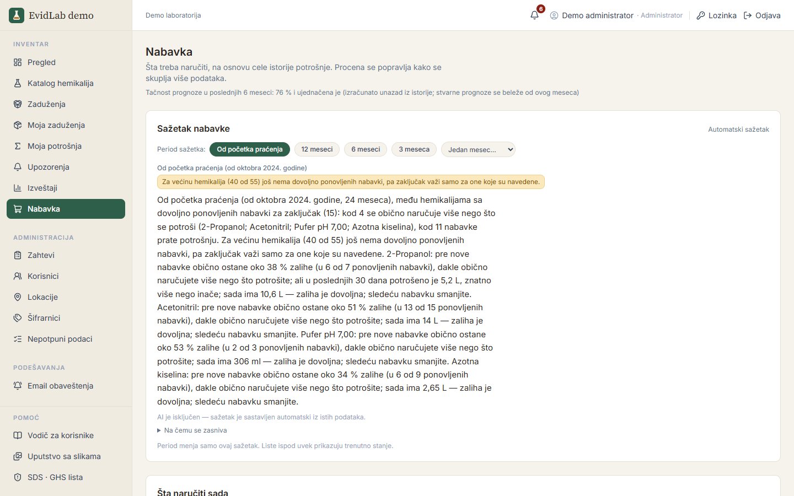 **Procurement**: recommendations and a plain-language summary built from the full consumption history |
| 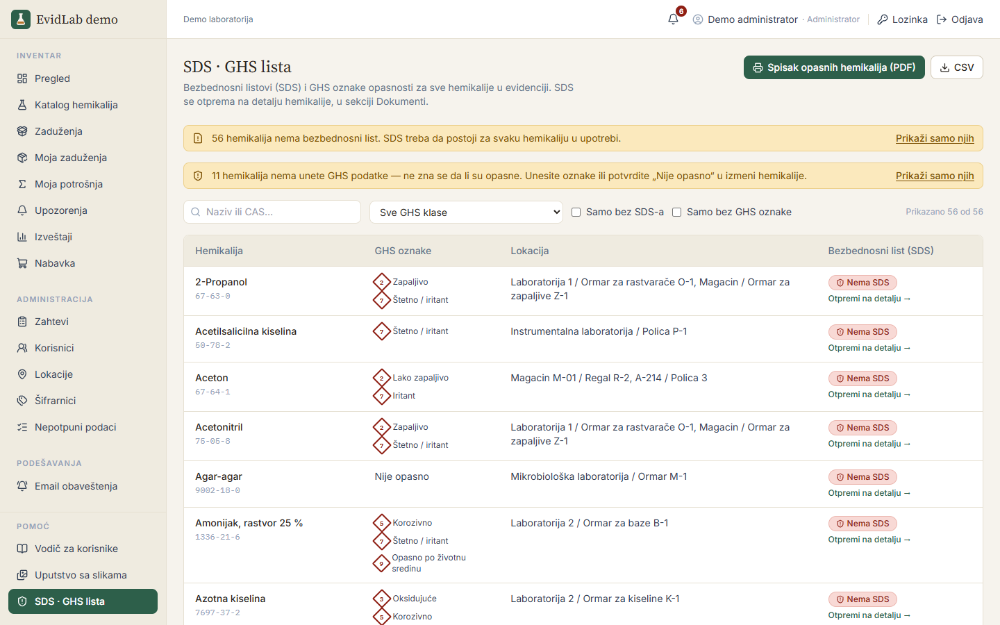 **SDS · GHS list**: missing safety sheets, hazard list with locations for inspections | 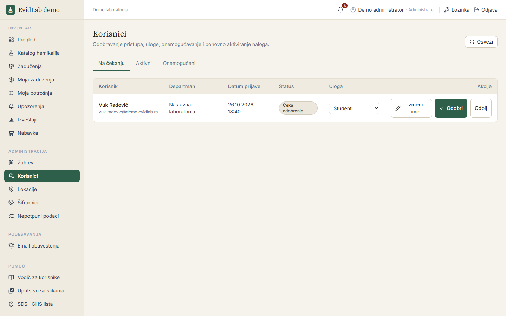 **Users**: approval, roles, disable/re-enable, and admin correction of a user's name |
| 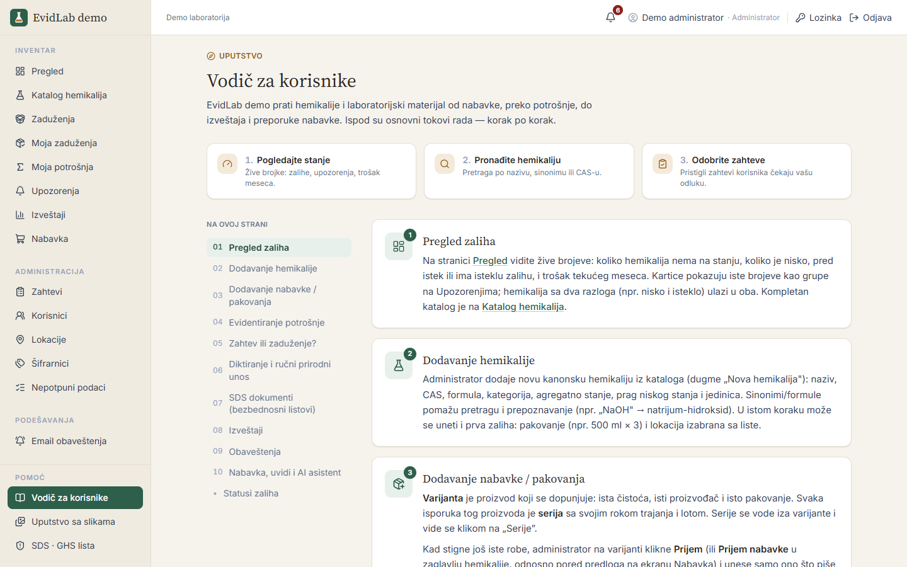 **In-app user guide** | 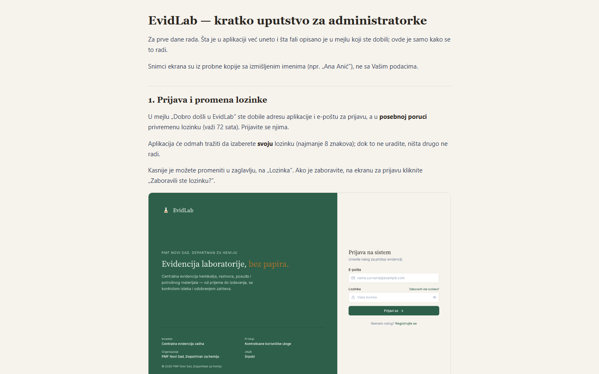 **Illustrated guide** for administrators, linked from the menu |

More: demo login and mobile

| | |
|---|---|
| 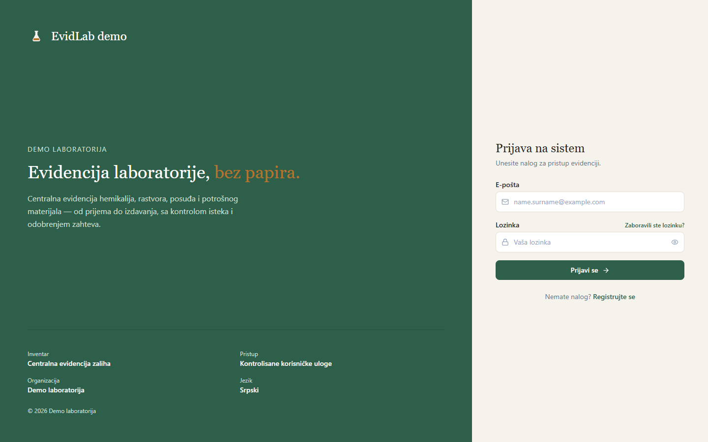 Demo login ("Demo laboratorija", no faculty branding) | 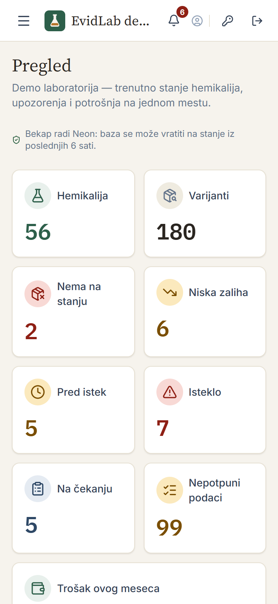 Dashboard at 375 px (collapsible menu) |

---

## The problem

The department tracked chemicals in **one shared Excel file plus paper notebooks**:

- no access control or history: anyone could edit, nobody knew who changed what;
- the same substance under several names (NaOH / sodium hydroxide / caustic soda), purities and package sizes with no link between them;
- expired stock got used by accident, shortages were noticed when an experiment stopped;
- no request/approval process and no link between consumption, person, project and cost;
- yearly consumption reports meant days of manual copying, and purchasing was based on gut feeling.

## The solution

A web application built around a few strict rules:

- **Canonical chemical → variants (products) → batches** (purity, manufacturer, supplier, package, lot, location, expiry) with synonyms/aliases, so duplicates disappear and search finds everything.
- **Stock is never typed in.** It is the sum of an **append-only ledger**: every receipt, issue, adjustment and write-off is recorded with who, when, why, for which project/purpose and at which purchase price. Nothing is deleted; chemicals and batches are archived with a reason.
- **Only administrators change stock**, through approved requests (they can also approve less than requested) or explicit receive / adjust / write-off actions.
- **Status is computed:** in stock / low (below a per-chemical threshold) / near expiry (90 days by default) / expired. Alerts and e-mail digests follow from it.
- **Reports** over any period, including semesters and the academic year, with CSV/PDF export: consumption, current stock, near expiry, low stock, stock value, write-offs & adjustments, consumption of expired stock.
- **Explainable procurement recommendations** from the full consumption history (method chosen by backtest, confidence, safety stock, lead time, whole packages). The app explains *why* it recommends an order.
- **Safety:** GHS hazard classes on every chemical, SDS upload, and a hazardous-chemicals list with locations for inspections.
- **Optional AI layer** (assistant over inventory data, request dictation, SDS summaries, procurement summary). It is an add-on: the app is **fully functional with AI switched off**.
- **Operations:** role-based access, JWT + rotating refresh tokens, password reset and admin-issued temporary passwords, rate limiting, security headers, backups with status shown in the app, Docker images, Render deployment.

## Architecture

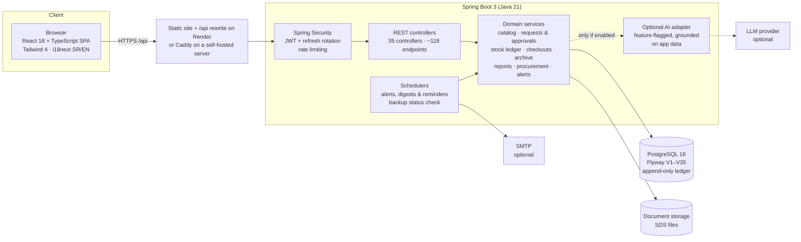

Deployments:

- **Pilot:** Render (Frankfurt). Managed Postgres, the backend as a Docker service with a disk for SDS files, and a static frontend that forwards `/api` with the same security headers. Backups are handled by the platform (point-in-time recovery plus disk snapshots), and the dashboard reports that state instead of a false warning.
- **Demo:** a second Render deployment on the free tier with Neon Postgres, seeded on startup with a fictional lab dataset.
- **Website:** a static Astro site on Vercel with a serverless contact form.
- **Self-hosted option:** Docker Compose with Caddy, scripted backups (GFS retention, off-server copy, restore tests), deploy and rollback scripts.

Key design decisions (55 ADRs in the private repo):

- **Stock integrity:** approvals run in a transaction with `SELECT … FOR UPDATE` row locks and are idempotent. Double approval and lost updates are covered by concurrency tests, and the database itself refuses negative stock.
- **Ledger, not counters:** movements are append-only with a value snapshot (FIFO by purchase price), so history and reports stay correct when prices change or are corrected later.
- **AI is an add-on, never a dependency:** every AI feature is gated by configuration, and with no provider all core flows still work.
- **Configurable single-tenant:** organisation name, currency, locale, time zone, purposes, categories and units are configuration/reference data, not code. The demo runs the same build as the pilot under a neutral name.

## Tech stack

| Layer | Technologies |
|---|---|
| Backend | Java 21, Spring Boot 3.3 (Web, Data JPA, Security, Validation, Actuator, Mail), Flyway, Apache PDFBox |
| Database | PostgreSQL 16, 35 Flyway migrations |
| Frontend | React 18, TypeScript 5, Vite 8, Tailwind CSS 4, React Router 7, Recharts, i18next (Serbian / English), lucide icons |
| Website | Astro 7, GSAP, Lenis; Vercel |
| Testing | JUnit 5 + Spring Boot Test against real PostgreSQL (~1,780 test methods; the last full run executed 2,145 tests, 0 failures), Vitest (832 frontend tests), Playwright E2E smoke specs |
| DevOps | Render Blueprints (pilot + demo), Docker, Docker Compose + Caddy for self-hosting, GitHub Actions CI plus a local CI script, Dependabot, gitleaks, npm audit |
| Process | Scrum: Sprint 0 + 5 sprints with a Sprint Review with the client after each; afterwards issue-driven work with peer-reviewed PRs, ADRs, a changelog and tagged releases (1.1.0 on 16 Oct 2026) |

## Numbers

Measured on the private repo on 27 Oct 2026 (`develop` = `main`, release 1.1.0).

| | |
|---|---|
| Development | May 2026 → ongoing (course defense 16 Jul 2026, product hardening, pilot from Oct 2026) |
| History | 1,100+ commits; 235 merged team PRs |
| Scale | ~33.6k lines of Java (main) + ~41k lines of Java tests, ~31k lines of TypeScript/TSX |
| API | ~118 REST endpoints across 35 controllers |
| Data model | 35 Flyway migrations |
| Tests | 2,145 backend tests and 832 frontend tests in the last full local CI run |
| Pilot data | the department's Excel register (131 chemicals, 205 variants) imported into the catalog |
| Course phase | 223 story points over 5 sprints |

## Team & my role

Three-person Scrum team (course *Information Systems Development Process*, PMF Novi Sad, 2025/26), working with the
Chemistry and Biology departments as the real client: **Sergej Stojanović, Nikola Vlačić, Boris Šejmeši**.

**My role (Sergej Stojanović):** data & catalog owner, database coordinator, QA and Scrum artefacts; later the AI
layer, procurement, production readiness and the pilot roll-out. I own the GitHub repository, review and merge PRs,
cut releases, and present the project to the department's users. I authored about two-thirds of the merged PRs.

What I built or led (from the PR history):

- **Data foundation:** canonical chemical → variant → batch model, catalog API, Flyway schema coordination (I assign migration numbers), seed data.
- **Catalog & stock:** locations, synonyms, filters, per-chemical audit timeline, SDS upload, receiving deliveries for existing chemicals, receipt price correction with an audit trail, FIFO valuation, archiving instead of deleting, duplicate detection, incomplete-data screen.
- **Requests & users:** "picked up" step, cancellation and reminders, read-only request queue for professors, passwords (change / reset by e-mail / temporary password from an admin), disabling accounts only when nothing is outstanding, admin correction of user names.
- **Reliability & security:** fix for double approval and lost updates on stock (row locking + concurrency tests), CORS per environment and security headers, money visible only to admins and professors, login rate limiting that counts only failures and doesn't trust client-supplied forwarding headers, DB constraints and indexes, CI scanning.
- **Procurement:** forecasting over the full history with backtest-based method choice, confidence and safety stock; accuracy tracking; plain-language and long-term summaries.
- **Deployment & operations:** production Docker images, Compose + Caddy, scripted backups with restore tests; the Render pilot deployment and the in-app backup status for it; release 1.1.0.
- **Pilot roll-out:** imported the department's Excel register (131 chemicals / 205 variants, CAS/formula/GHS added from PubChem only when unambiguous), set up administrator accounts, and prepared the onboarding mails and the illustrated guide that is now linked from the app menu.
- **Demo & website:** the public demo deployment with a generated "two years of use" dataset, and the public website on Vercel (both built with AI coding assistance and reviewed by me).
- **Optional AI features:** SDS summaries/Q&A, request dictation, a tool-calling assistant grounded on inventory data with a golden-scenario test harness, all behind a feature flag.

Teammates: **Nikola Vlačić** owned authentication & users, loans, e-mail notifications, and in the pilot phase
"approve less than requested", the write-offs report, the checkouts report and PDF fixes, consumption by project,
and rate limits and secret guards. **Boris Šejmeši** built the frontend foundation, request approval / stock
transactions, reports and the original procurement algorithm, and later the dashboard charts, the Reports screen,
the hazardous-chemicals list, the responsible person on a batch, the shared network layer and the Tailwind 4 migration.

## Status

- Defended as a course project on 16 July 2026.
- Presented to the departments' future users on 23 September 2026; their feedback drove the October work (dashboard charts, reports, procurement over the full history, package checkouts).
- **Release 1.1.0 (16 Oct 2026) is in pilot use at the Department of Chemistry, PMF Novi Sad**, hosted on Render, with official adoption to follow. Pilot results will be published when the pilot ends.
- A public website and a demo instance with fictional data are live for other labs.
- A generic product fork (English/Serbian UI) was also pitched at a health-tech hackathon in July 2026.

## Why the code is private

The application is in use at a university department and the repository contains the work of three people. This
showcase shows what the system does and what I contributed without publishing the codebase, configuration or
infrastructure details. I'm happy to walk through the code and design decisions in an interview.

## Contact

**Sergej Stojanović**, Information Technologies student, Faculty of Sciences, University of Novi Sad
GitHub: [@Excapex](https://github.com/Excapex) · LinkedIn: [sergej-stojanovic-4a875836a](https://www.linkedin.com/in/sergej-stojanovic-4a875836a/)
