

# EvidLab

**Chemical & lab-material inventory for a university chemistry department — replacing a shared Excel sheet with approvals, a full audit trail, GHS safety data and explainable procurement.**

*Team project · Faculty of Sciences (PMF), University of Novi Sad · real departmental client · in pilot testing ahead of official adoption*

> **Source code is private.** The system is being piloted for official use at the faculty and the codebase
> contains teammates' work, so this repository is a showcase only: screenshots, architecture and my role.
> All screenshots use a **fictional demo dataset** (demo lab, demo users, demo suppliers) — no real inventory data.

---

## Gallery

| | |
|---|---|
|  **Dashboard** — stock health, expiry, pending requests, monthly cost | 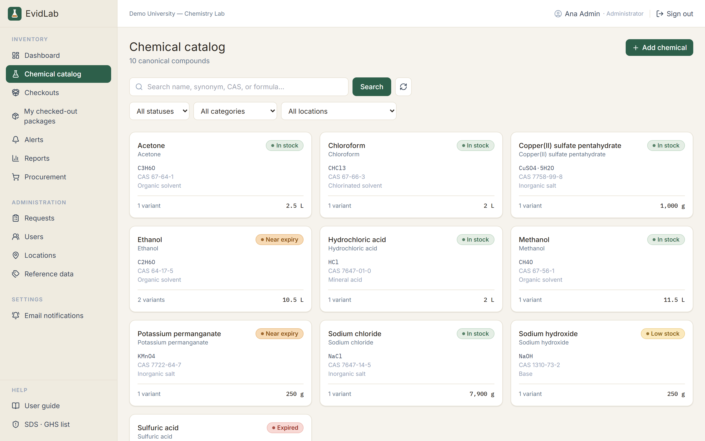 **Chemical catalog** — canonical chemical → variants, live status |
| 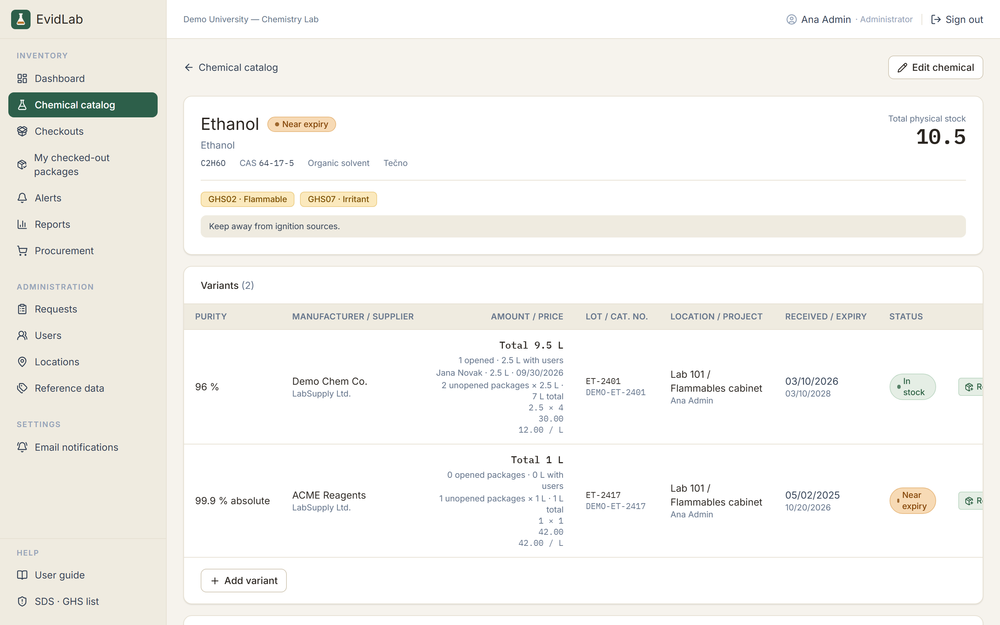 **Chemical detail** — GHS pictograms, variants (purity, lot, location, expiry), opened packages | 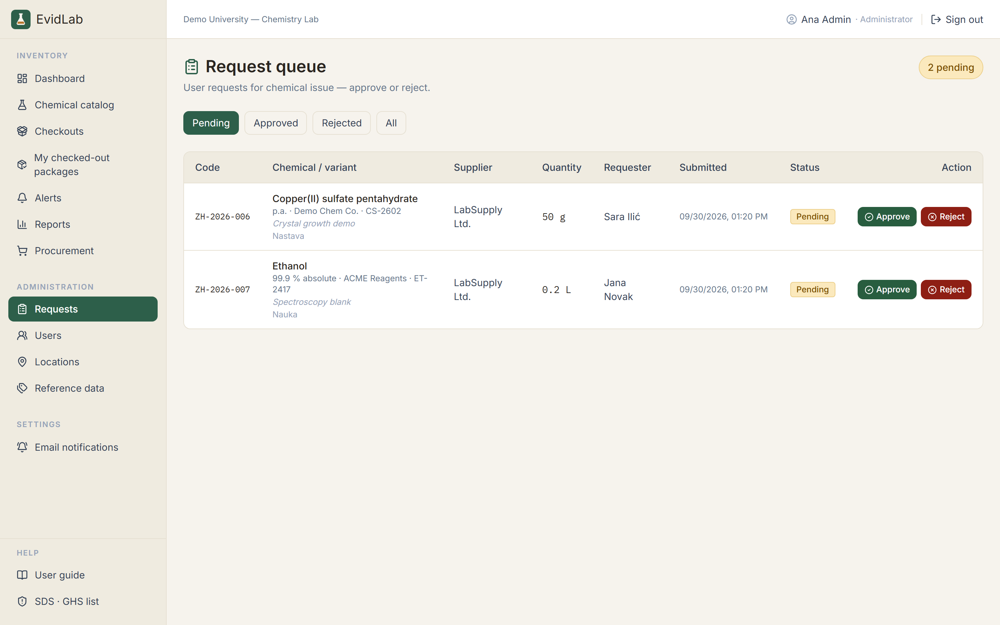 **Request queue** — only admins change stock, via approved requests |
| 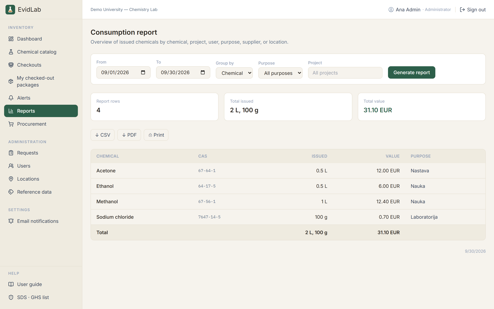 **Reports** — consumption by chemical / project / user / purpose / supplier / location, CSV & PDF export | 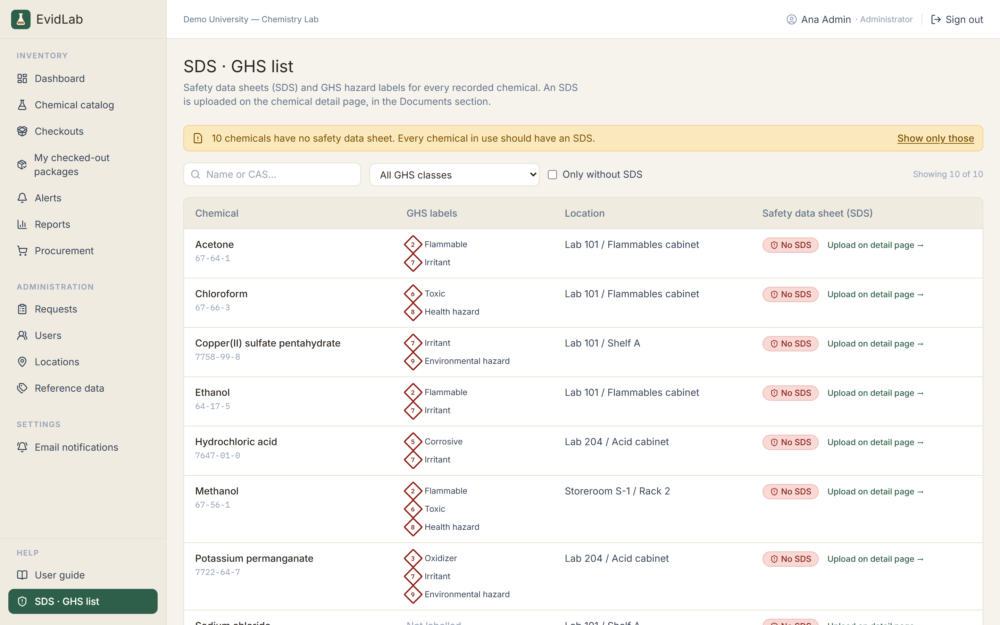 **SDS · GHS list** — hazard classes and missing safety data sheets at a glance |
| 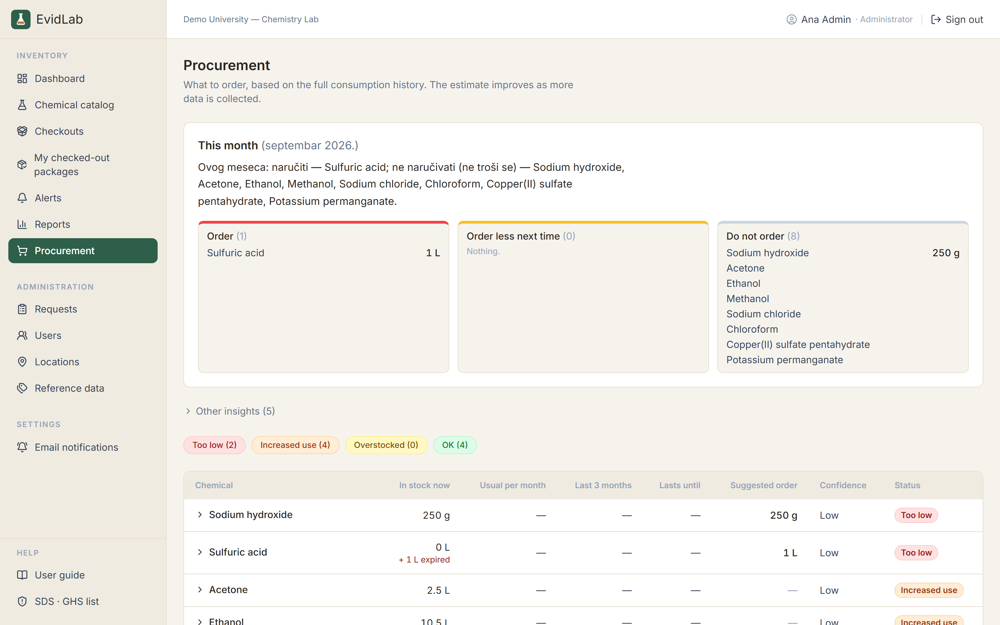 **Procurement** — explainable "order / order less / don't order" recommendations from consumption history | 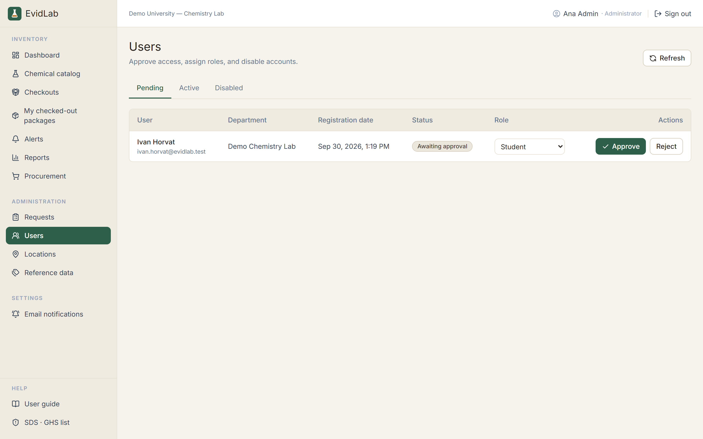 **Admin · users** — self-registration, approval, role assignment |

More screenshots (filters, alerts, packages, locations, Serbian UI, login)

| | |
|---|---|
| 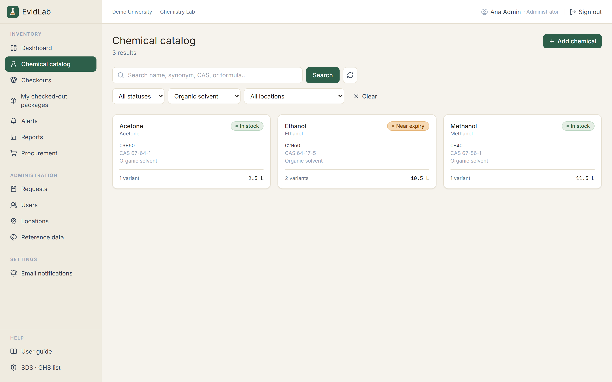 Catalog filtered by category | 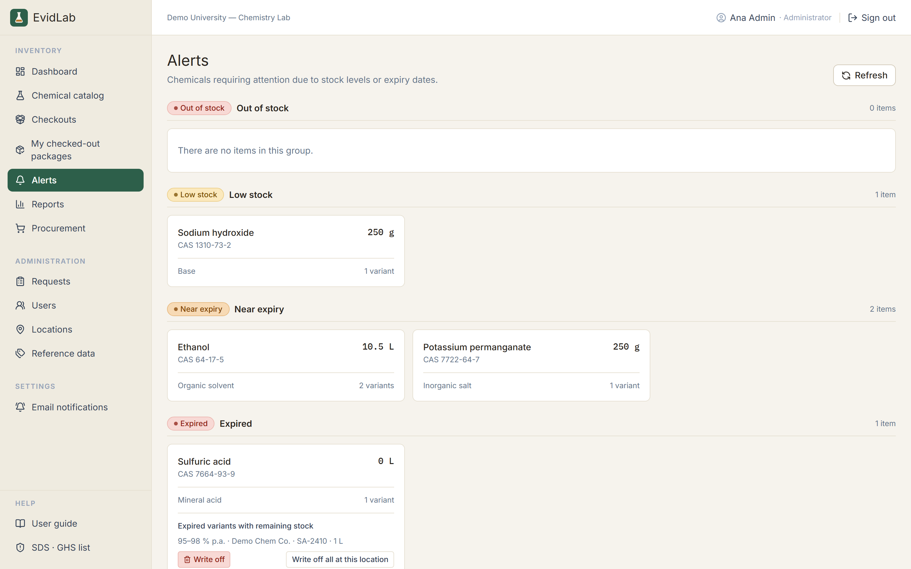 Low-stock / near-expiry / expired alerts |
| 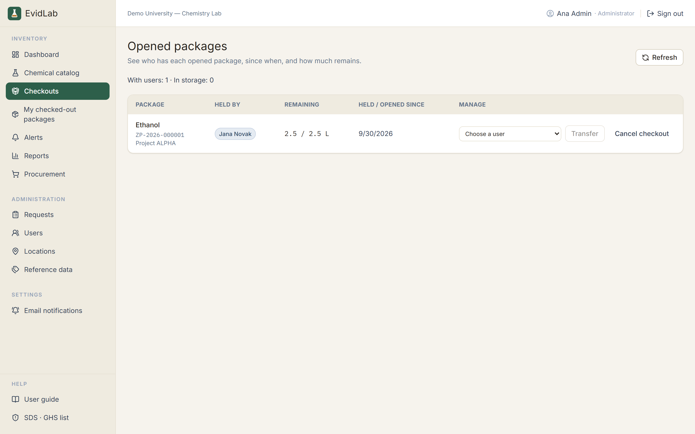 Checked-out & opened packages | 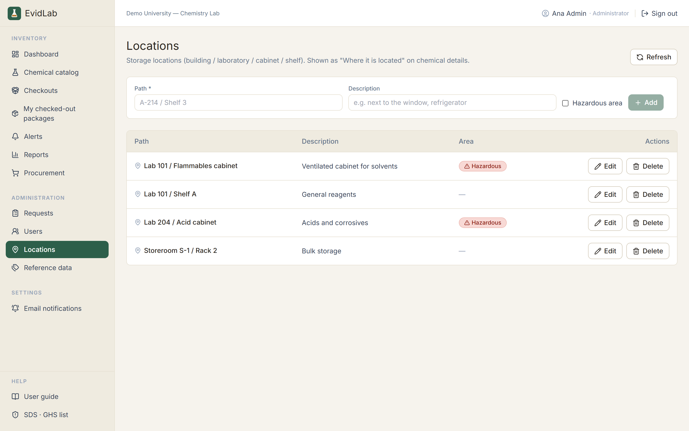 Storage locations (hazard zones) |
| 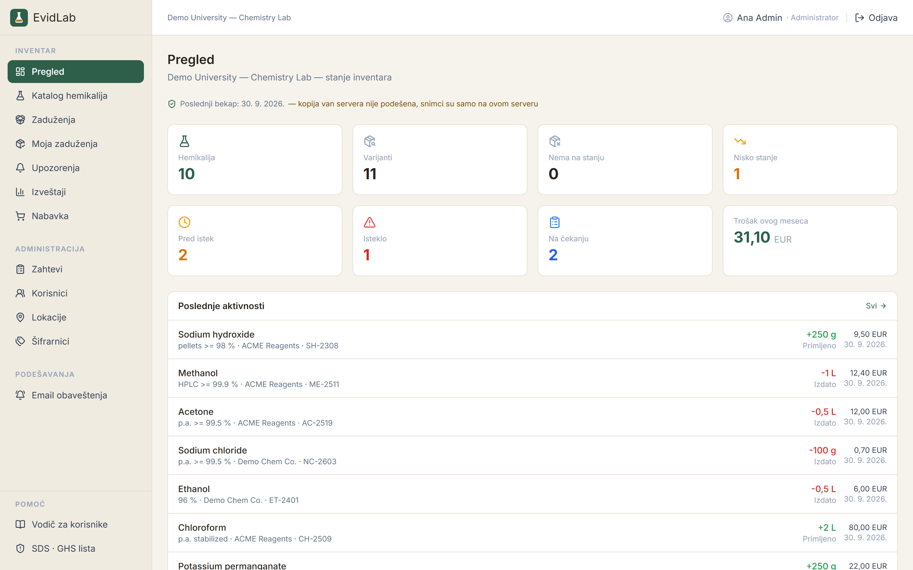 Same dashboard in Serbian (locale per installation) | 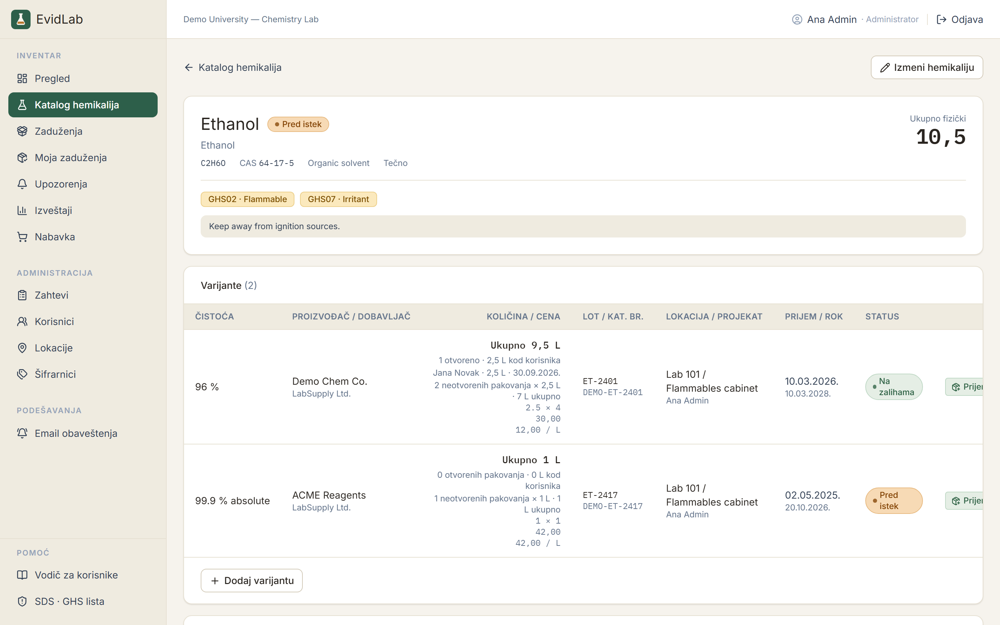 Chemical detail in Serbian |
| 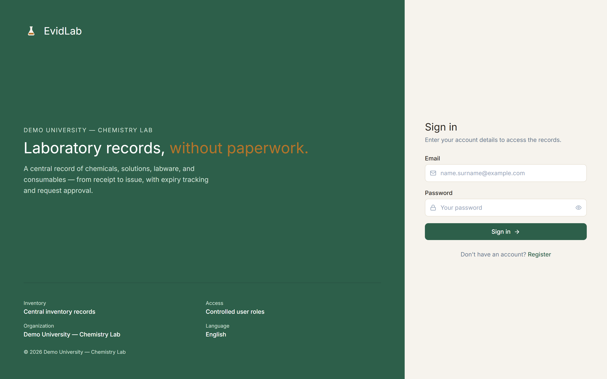 Login (EN) | 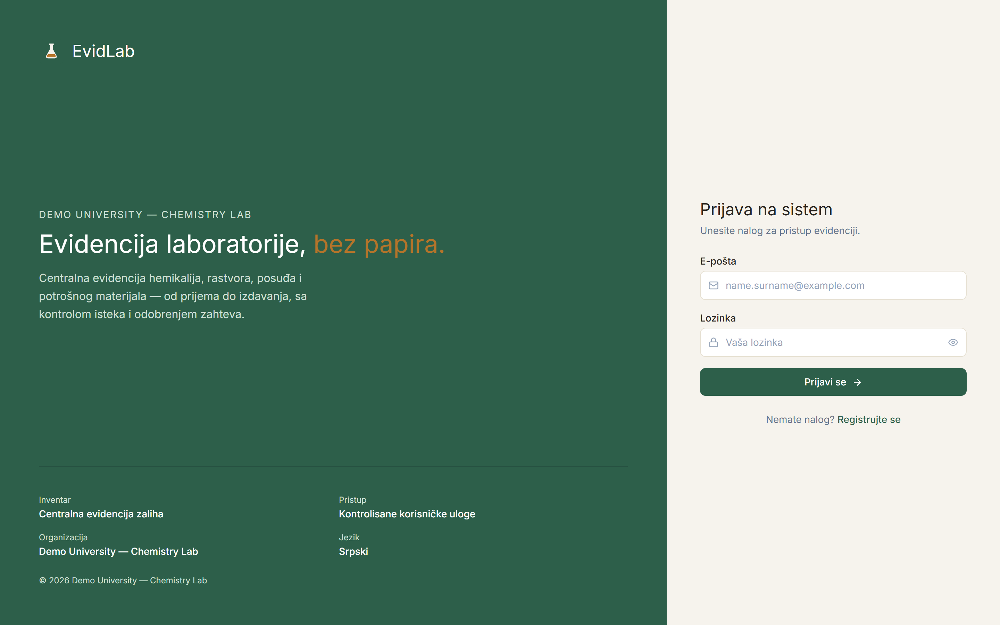 Login (SR) |

---

## The problem

The department tracked chemicals in **one shared Excel file plus paper notebooks**:

- no access control or history — anyone could edit, nobody knew who changed what;
- the same substance under several names (NaOH / sodium hydroxide / caustic soda), purities and package sizes with no link between them;
- expired stock got used by accident, shortages were noticed when an experiment stopped;
- no request/approval process and no link between consumption, person, project and cost;
- yearly consumption reports meant days of manual copying, and purchasing was based on gut feeling.

## The solution

A web application built around a few strict rules:

- **Canonical chemical → variants** (purity, manufacturer, supplier, package, lot, location, expiry) with synonyms/aliases, so duplicates disappear and search finds everything.
- **Only administrators change stock, and only through approved requests** (or explicit receive / adjust / write-off actions).
- **Append-only stock ledger** — every movement is recorded with who, when, why, for which project/purpose and its monetary value.
- **Alerts** for low stock, near-expiry and expired items; e-mail digests (optional).
- **Reports** over any period by 6 dimensions with CSV/PDF export, plus operational reports (stock, expiring, low stock, stock value).
- **Explainable procurement recommendations** built from the full consumption history (method chosen by backtest, confidence, safety stock) — the app says *why* it recommends an order.
- **Safety:** GHS hazard classes on every chemical, SDS upload per chemical and an SDS/GHS overview.
- **Optional AI layer** (assistant over inventory data, dictation of requests, SDS summaries) designed as an add-on: the app is **fully functional with AI switched off**.
- **Operations:** role-based access, JWT + refresh tokens, rate limiting, security headers, scheduled backups with restore tests and backup status shown in the app, production Docker images.

## Architecture

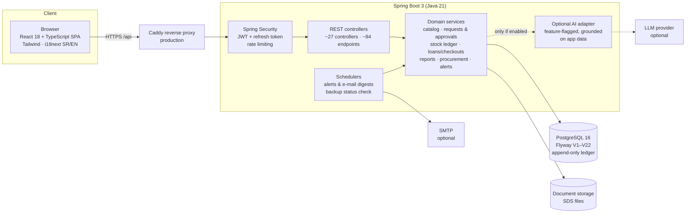

Key design decisions (documented as ADRs in the private repo):

- **Stock integrity:** approvals run in a transaction with `SELECT … FOR UPDATE` row locks and are idempotent — double-approval and lost updates are covered by concurrency tests.
- **Ledger, not counters:** stock movements are append-only records with a value snapshot, so history and reports stay correct even when prices change.
- **AI is an add-on, never a dependency:** every AI feature is gated by configuration; with no provider the app degrades gracefully and all core flows still work.
- **Configurable single-tenant:** organisation name, currency, locale, purposes, categories and units are configuration/reference data, not code — the same build can be installed for another lab.

## Tech stack

| Layer | Technologies |
|---|---|
| Backend | Java 21, Spring Boot 3.3 (Web, Data JPA, Security, Validation, Actuator, Mail), Flyway, Apache PDFBox |
| Database | PostgreSQL 16, 22 Flyway migrations |
| Frontend | React 18, TypeScript 5, Vite 8, Tailwind CSS 3, i18next (Serbian / English), lucide icons |
| Testing | JUnit 5 + Spring Boot Test (~580 backend test methods in 98 test classes, run against real PostgreSQL in CI), Vitest unit tests, Playwright E2E smoke tests |
| DevOps | Docker Compose (dev + production stack), Caddy, GitHub Actions CI (lint, typecheck, unit tests, build, backend tests), Dependabot, gitleaks, scripted backup / restore-test / rollback |
| Process | Scrum: Sprint 0 + 5 sprints, Sprint Review with the client after every sprint, burndown charts, ADRs, GitHub issues/PRs |

## Numbers

| | |
|---|---|
| Development | May 2026 → ongoing (course defense 16 Jul 2026, then product hardening for pilot) |
| Scale | ~16.9k lines of Java (main) + ~11.6k lines of Java tests, ~11.8k lines of TypeScript/TSX |
| API | ~84 REST endpoints across 27 controllers |
| Data model | 22 Flyway migrations |
| Delivery | 223 story points over 5 sprints; ~140 merged team PRs |

## Team & my role

Three-person Scrum team (course *Information Systems Development Process*, PMF Novi Sad, 2025/26), working with a
the Chemistry and Biology departments as the real client.

**My role — Sergej Stojanović:** data & catalog owner, database coordinator, QA and Scrum artefacts; later the AI layer,
procurement and production-readiness work. I also own the GitHub repository and presented the project to the
department's future users.

What I built / led (from the PR history):

- **Data foundation:** canonical chemical → variant model, catalog read/write API, Flyway schema coordination across the team, seed data.
- **Catalog management:** locations, synonyms/aliases, catalog filters, edit flows, per-chemical history / audit timeline, SDS document upload.
- **Reliability & security hardening:** fix for double approval and lost updates on stock (row locking + concurrency tests), CORS per environment + security headers, gitleaks / Dependabot / npm-audit in CI, cleaner API error handling.
- **Procurement v3:** forecasting over the full consumption history with method selection by backtest, confidence and safety stock, forecast-accuracy tracking, redesigned procurement screen.
- **Operations:** production Docker images + compose stack with Caddy, automated backups (GFS retention, off-server copy, restore tests) with status shown in the app, ops documentation.
- **Optional AI features:** SDS summaries/Q&A, voice/text dictation of requests, a tool-calling assistant grounded on inventory data with a golden-scenario test harness — all behind a feature flag.
- **Frontend dependency upgrades** (Vite 5→8, ESLint 10, React Router 7) and much of the project documentation, sprint reviews and presentations.

Teammates owned authentication & users, loans and e-mail notifications (Nikola Vlačić) and the frontend foundation,
request approval / stock transactions, reports and the original procurement algorithm (Boris Šejmeši).

## Status

- Defended as a course project on 16 July 2026.
- Hardened afterwards for real use (backups, security, deployment, generalisation beyond one faculty).
- Presented to the departments' future users in September 2026; **now in pilot testing, with official adoption to follow.**
- A generic product fork (English/Serbian UI) was also pitched at a health-tech hackathon in July 2026.

## Why the code is private

The application is going into production use at a university department and the repository contains the work of
three people. This showcase shows what the system does and what I contributed without publishing the codebase,
configuration or infrastructure details. I'm happy to walk through the code and design decisions in an interview.

## Contact

**Sergej Stojanović** — Information Technologies student, Faculty of Sciences, University of Novi Sad
GitHub: [@Excapex](https://github.com/Excapex) · LinkedIn: [sergej-stojanovic-4a875836a](https://www.linkedin.com/in/sergej-stojanovic-4a875836a/)
